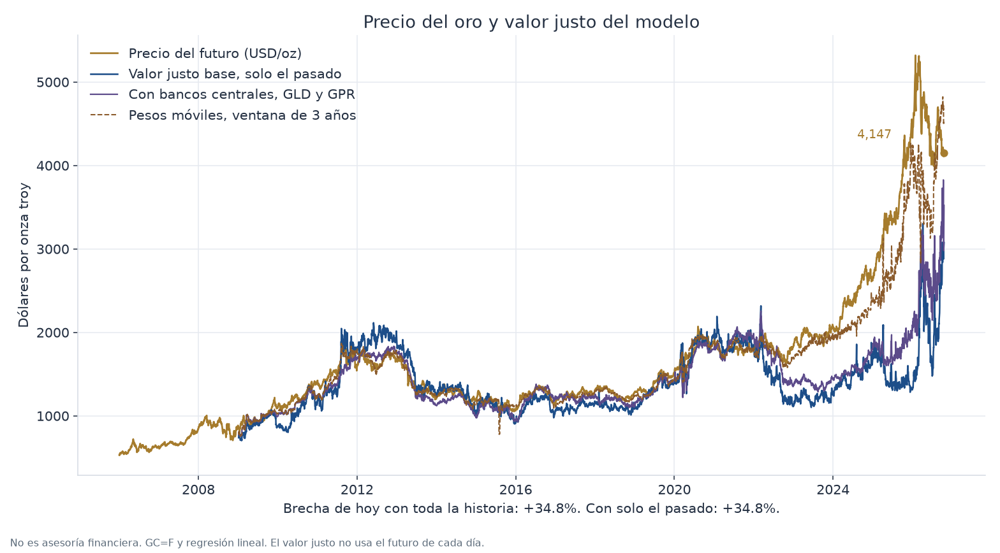
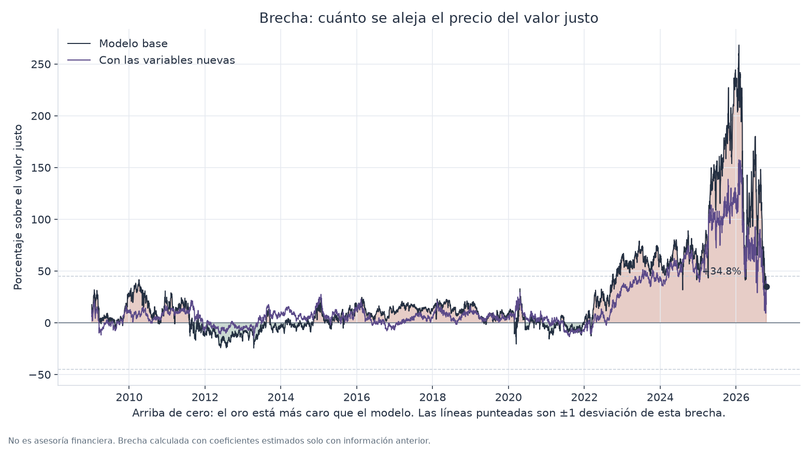
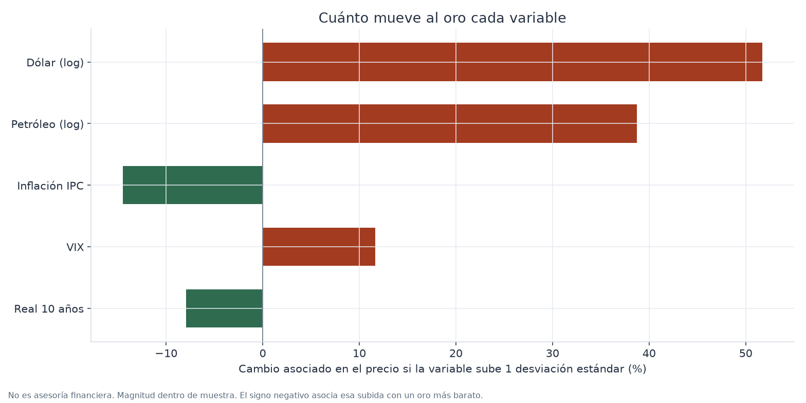
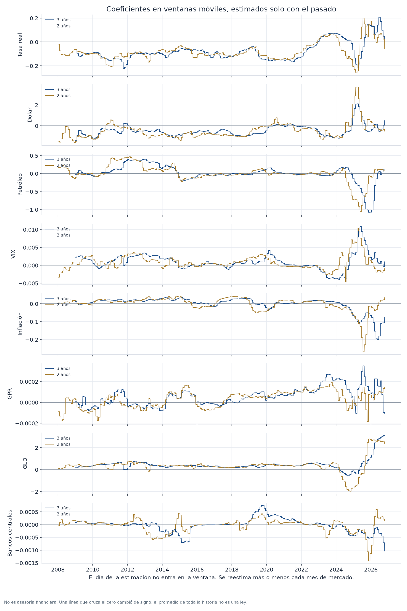
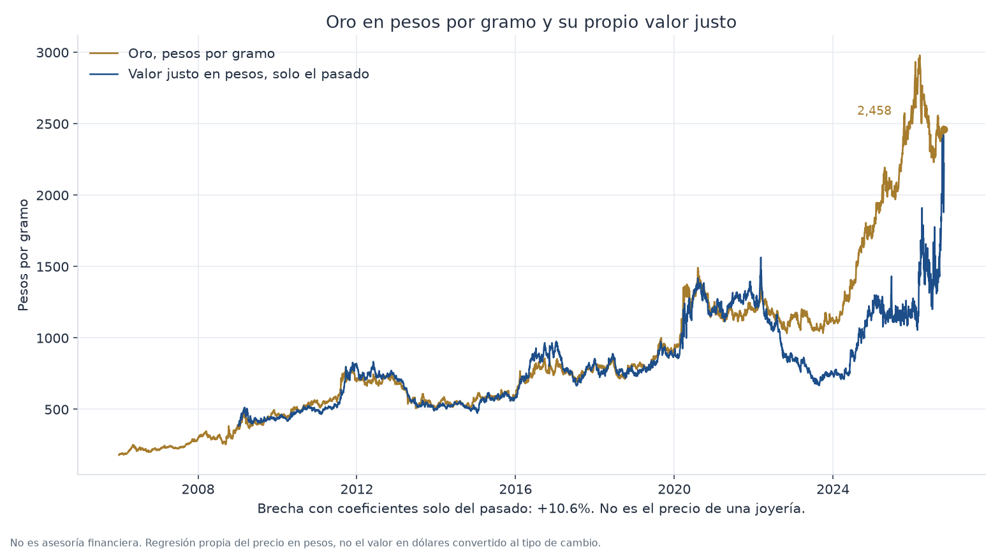

# Gold price regressions

A small Python study of the gold price. It is not financial advice.

**What it does.** A fair-value regression of log(gold) on the 10-year real yield, log(USD index), log(Brent), VIX, and inflation, with Newey–West errors. An extended fair value adds central-bank net gold purchases, log(GLD holdings), and the Caldara–Iacoviello geopolitical risk index, each lagged so it is not used before it is public. The same equation is re-estimated on rolling 2-year and 3-year windows. Engle–Granger and Johansen tests look for cointegration on weekly data, and an error-correction half-life is reported only when a relation is found. Walk-forward Ridge and gradient-boosting forecasts of 5-day and 20-day returns are compared with a random walk and with the training-window mean; those forecasts also use CFTC COT positioning and the 2-year nominal yield. A separate regression and forecast covers gold in Mexican pesos per gram. The sample is about 20 years of daily data from yfinance, FRED, and the public backups those series use.

**Results, as of 19 October 2026.** COMEX gold at $4,146.80/oz sits about +35% above the base walk-forward fair value. Adding central-bank purchases, GLD holdings, and geopolitical risk closes about 17 percentage points of that gap and leaves it near +18%. The latest 2-year and 3-year windows put the price about 11% and 8% below those shorter-sample values. Engle–Granger (p = 0.87) and Johansen (trace 18.8 against a 5% critical value of 29.8) do not find cointegration, so no equilibrium half-life is reported. Out-of-sample R² is negative for both Ridge and gradient boosting: about −0.02 and −0.05 for Ridge at 5 and 20 days against a random walk, and about −0.04 and −0.04 for boosting. Neither beats a random walk or the training-window mean. The signs on the real yield and the USD index flipped after 2022. In pesos per gram the metal is about +11% above its own fair value.

**How to run.**

```text
pip install -r requirements.txt
python pruebas.py
python main.py
```

`pruebas.py` is the offline check (23 tests). `main.py` downloads the data and writes the report and the charts below.











The rest of this file is in Spanish.

# Oro: dos regresiones para entender el precio

Proyecto pequeño, en Python, para ver **cómo se mueve el oro** y qué tan
lejos está el precio de una relación histórica sencilla con tasas, dólar,
petróleo, volatilidad e inflación.

Sirve para estudiar y para explicarle a alguien, con números a la vista,
qué dice un modelo lineal. **No es asesoría financiera.** El oro a unos
días o a un mes es difícil de pronosticar: la mayor parte del movimiento
es ruido. Si el informe dice que el modelo no le gana a un promedio, esa
es la respuesta correcta. No hay que forzarla.

Hoy el programa usa el futuro continuo del COMEX (`GC=F`), en dólares por
onza troy. También lo pasa a **pesos por gramo** con el tipo de cambio
USD/MXN. Ese peso por gramo es el valor del metal en el mercado mayorista.
Una joyería o un banco en México cobra una prima encima, y a veces publica
el precio con el FIX de Banxico, no con el tipo de cambio de Yahoo.

## Qué vas a obtener

Al correr `python main.py` el programa:

1. Descarga unos 20 años de datos diarios (desde 2006) y los guarda en `data/`.
2. Ajusta un **valor justo** del nivel del oro y dice cuántos por ciento
   está el precio por arriba o por abajo.
3. Ajusta un **pronóstico** del retorno a 5 y a 20 días de mercado, solo
   con información ya conocida ese día, y lo compara con dos baselines.
4. Imprime un informe en español y guarda gráficas en `outputs/`.

## Cómo instalarlo

Necesitas **Python 3.11 o más nuevo**. Compruébalo:

```text
python --version
```

En Mac, si ese comando no existe, prueba `python3 --version`.

Entra a la carpeta del proyecto (donde está este README) y crea un entorno
virtual. Así las librerías no se mezclan con las del resto de la computadora.

### Windows (PowerShell o el Símbolo del sistema)

```text
py -m venv .venv
.venv\Scripts\activate
python -m pip install --upgrade pip
pip install -r requirements.txt
```

Si `py` no existe, usa `python -m venv .venv`.

Si las letras con acento salen raras, abre **Windows Terminal** o, en el
símbolo del sistema, corre antes `chcp 65001`.

### Mac

```text
python3 -m venv .venv
source .venv/bin/activate
python -m pip install --upgrade pip
pip install -r requirements.txt
```

## Cómo correrlo

Con el entorno activado (ves `(.venv)` al inicio de la línea):

```text
python main.py
```

La primera vez tarda unos minutos: baja precios de Yahoo Finance y series
macro del Tesoro de EE.UU., el BLS, la Fed de Nueva York y el CBOE.
Los años viejos del Tesoro se quedan en `data/raw/` y la siguiente corrida
solo refresca lo reciente.

Las comprobaciones que no usan internet:

```text
python pruebas.py
```

Ahí se revisa, por ejemplo, que el IPC de un mes no se use antes de su
fecha de publicación, y que el entrenamiento del pronóstico no vea el futuro.

## Mapa de los archivos

| Archivo | Para qué está |
| --- | --- |
| `main.py` | El único comando. Llama a lo demás en orden. |
| `datos.py` | Descarga, alinea los días y aplica la regla del IPC. |
| `modelos.py` | Las dos regresiones y las métricas fuera de muestra. |
| `reporte.py` | El texto del informe y las gráficas. |
| `pruebas.py` | Pruebas pequeñas, sin red. |
| `requirements.txt` | Librerías. `pip` las instala. |
| `data/panel_diario.csv` | La tabla ya alineada. Se reescribe en cada corrida. |
| `referencia/snapshot_2026-10-05.csv` | Una nota de precios del 5 de octubre de 2026, solo para comparar. No se usa para estimar. |
| `outputs/` | Informe, gráficas y tablas de métricas. |

`Path(__file__)` en el código es la carpeta del archivo, no la carpeta
desde la que escribiste el comando. Puedes correr `python main.py` desde
otro sitio y los datos siguen cayendo aquí.

## De dónde salen los datos

El programa **intenta primero FRED**, con el CSV público, sin llave:

`https://fred.stlouisfed.org/graph/fredgraph.csv?id=DFII10`

(y lo mismo para `DGS10`, `T10YIE`, `DGS2`, `DFF`, `VIXCLS`,
`DCOILBRENTEU`, `DTWEXBGS`, `DEXMXUS`, `CPIAUCSL`).

Si FRED no contesta, usa un respaldo gratuito de la misma idea. El informe
dice cuál usó.

| Idea | FRED | Respaldo si FRED no responde |
| --- | --- | --- |
| Oro | FRED ya no publica el LBMA | Yahoo `GC=F` (futuro COMEX), vía yfinance |
| Tasa real 10 años | `DFII10` | Tesoro de EE.UU., curva real |
| Tasa nominal 10 y 2 años | `DGS10`, `DGS2` | Tesoro de EE.UU., curva nominal |
| Breakeven 10 años | `T10YIE` | Nominal menos real. **No entra al modelo junto con la tasa real**: sería contar lo mismo dos veces. |
| Dólar | `DTWEXBGS` (índice amplio, solo si FRED responde) | Yahoo `DX-Y.NYB`, el índice dólar que suele citar la prensa. El modelo usa este. |
| VIX | `VIXCLS` | Histórico diario de CBOE, o Yahoo `^VIX` |
| Petróleo | `DCOILBRENTEU` (Brent spot) | Yahoo `BZ=F` (futuro Brent) |
| Bolsa | — | Yahoo `^GSPC` (S&P 500) |
| Plata y precio de GLD | — | Yahoo `SI=F`, `GLD`. Quedan en la tabla. El precio de GLD no entra al valor justo. |
| Pesos por dólar | `DEXMXUS` | Yahoo `MXN=X` |
| Fondos federales | `DFF` | Fed de Nueva York, tasa efectiva (EFFR) |
| IPC de EE.UU. | `CPIAUCSL` | BLS `CUSR0000SA0` (IPC-U ajustado por estacionalidad) |

Otros tickers que pide yfinance, para tener la tabla completa: `^TNX`
(chequeo de la tasa a 10 años).

### El IPC y el adelanto

El IPC de agosto no se conoce el 1 de agosto. En este proyecto se trata
como conocido desde el **día 15 del mes siguiente**. Si ese día es sábado
o domingo, pasa al lunes. Es una regla fija, un poco tardía a propósito:
mejor enterarse unos días después que usar el dato antes de tiempo.

El nivel histórico del IPC es el que el BLS publica **hoy**, ya revisado,
no la primera cifra de cada mes. La regla del día 15 evita adelantar el
mes; no reconstruye esas revisiones. Para un pronóstico de unos días, esa
limitación es pequeña al lado del ruido del precio.

### Huecos

El calendario es el del oro: solo días en que `GC=F` tiene cierre. Si una
tasa falta por feriado, se copia el último valor **hacia adelante**, como
máximo 5 días de mercado. No se copia hacia atrás. El precio del oro no se
rellena: un precio inventado falsearía el rendimiento.

## Las dos regresiones

Las dos usan el logaritmo del precio. Trabajar en logaritmo hace que un
coeficiente se lea, en corto, como un cambio porcentual.

Un **día** aquí es un día en que el futuro negoció, no un día de calendario.
Cinco días de mercado son una semana hábil. Veinte son cerca de un mes.

### 1. Valor justo (niveles)

```text
log(oro) = constante
         + b1 × tasa real a 10 años
         + b2 × log(índice dólar)
         + b3 × log(Brent)
         + b4 × VIX
         + b5 × inflación anual ya publicada
```

- La tasa real va en puntos porcentuales (2.95 significa 2.95%), igual que la inflación.
- El dólar y el petróleo van en logaritmo: el coeficiente es una elasticidad
  (un dólar 1% más alto se asocia con cerca de b2% en el oro).
- La plata, el S&P 500 y la tasa de fondos federales **no** entran. La plata
  copia al oro. La bolsa y el oro suben juntos por tendencia y eso inflaría
  un "valor justo" falso. La tasa de un día se parece a la tasa real y
  embarra los coeficientes.
- Los errores estándar son de **Newey-West con 21 rezagos**. En una
  regresión de niveles los errores de días seguidos se parecen; si se
  ignorara eso, parecería que conocemos el coeficiente con una precisión
  que no tenemos. Si el valor absoluto de `t` (coeficiente / error estándar)
  no llega a 2, el dato no separa ese coeficiente de cero.
- El R² de esta regresión, dentro de la muestra, **no** es la nota del
  pronóstico. Series que suben durante años producen un R² alto con
  facilidad. El informe lo compara con el R² de una simple línea de tiempo.

La **brecha** es `precio / valor justo − 1`.

Hay dos brechas el día del informe:

- Con los coeficientes de **toda** la historia: "según la relación promedio
  de la muestra, ¿el oro está caro o barato?"
- **Caminando hacia adelante**: cada día, los coeficientes salen solo de
  días anteriores. Esta es la brecha que luego usa el pronóstico, para no
  colar el futuro. También es la línea de las gráficas.

El modelo base no ve compras de bancos centrales ni geopolítica. Esas
series entran en un segundo valor justo (sección de abajo). Una brecha
grande puede ser "el oro está caro" o "al modelo le faltan piezas". El
informe lo dice cuando la brecha pasa de 15%, y mide si las series nuevas
la cierran.

### 2. Pronóstico (retornos a 5 y 20 días)

La respuesta del día `t` es el retorno logarítmico del oro entre `t` y
`t+5`, o entre `t` y `t+20`. Esa columna mira al futuro (`shift` negativo)
y **solo** se usa como respuesta. Nunca como dato de entrada.

Los datos de entrada, todos conocidos en `t`, son:

- retorno del oro a 5, 20 y 60 días (lo que ya pasó);
- cambio a 20 días de la tasa real, del dólar, del petróleo y del S&P 500;
- cambio a 5 días del VIX;
- nivel de la tasa real, del VIX y de la inflación conocida;
- la brecha del valor justo calculada solo con el pasado.

El modelo es una **regresión Ridge**: es una regresión lineal con una
penalización para que coeficientes de columnas parecidas no se vuelvan
enormes. Antes de ajustar, cada columna se resta su media y se divide
entre su desviación, usando **solo** la ventana de entrenamiento. Si no,
el VIX (números cerca de 15) aplastaría a un retorno (números cerca de 0.01).

La penalización se elige dentro del entrenamiento, con el último tramo de
esa ventana. No se usa `train_test_split`: esa función baraja las filas y
el futuro se mezclaría con el pasado.

**Walk-forward.** Se reentrena más o menos cada 21 sesiones. Para predecir
el día `t`, el entrenamiento solo incluye filas `i` con `i + horizonte <= t`.
Así la respuesta de entrenamiento ya ocurrió. Los últimos 5 o 20 días del
informe tienen pronóstico, pero todavía no tienen respuesta realizada, y
por eso no entran a la nota.

### Cómo leer la nota del pronóstico

Hay dos formas de contar los días de prueba:

- **Sin solapar** (la que hay que mirar primero): una observación cada 5 o
  cada 20 sesiones. Un retorno de 20 días comparte 19 días con el del día
  siguiente; contarlos como éxitos distintos infla la seguridad.
- **Solapado**: todos los días. Viene abajo, con el tamaño de muestra, para
  que se vea la diferencia.

Métricas, fuera de muestra:

- **R² contra cero.** Baseline: predecir que el retorno es 0 (caminata
  aleatoria, sin deriva). R² negativo: el modelo se equivoca más que "el
  precio no cambia".
- **R² contra el promedio.** Baseline: predecir el retorno medio de la
  ventana de entrenamiento. Es más exigente. Un modelo que siempre dice
  "sube un poquito" puede ganarle al cero solo porque el oro, en el pasado,
  ha subido. Si no le gana al promedio, no demostró timing.
- **RMSE.** Error típico, en por ciento aproximado (el RMSE del retorno
  logarítmico × 100). Compáralo con el RMSE de cada baseline. Si son casi
  iguales, el modelo no aporta.
- **Acierto de dirección.** Fracción de veces en que el signo del pronóstico
  coincide con el signo del retorno, ignorando retornos de cero exacto.
  Al lado está el acierto de **siempre alza** (la fracción de periodos en
  que el oro sí subió) y el del signo del promedio. Si el modelo acierta
  lo mismo que "siempre alza", no está eligiendo los días: está repitiendo
  que el oro suele subir.

La banda del informe es el pronóstico ± un RMSE fuera de muestra. Si la
señal cabe varias veces en esa banda, la dirección no alcanza para comprar
o vender.

## Las gráficas

En `outputs/`:

- `precio_vs_valor_justo.png` — precio, valor justo base, valor justo ampliado y ventana de 3 años.
- `brecha_valor_justo.png` — la brecha en por ciento. Arriba de cero: más caro que el modelo.
- `coeficientes_valor_justo.png` — efecto de mover cada variable una desviación estándar de la muestra. Eso es un cambio grande entre niveles históricos, no un salto de un día.
- `coeficientes_moviles.png` — el camino de cada coeficiente en ventanas de 2 y 3 años.
- `oro_mxn_vs_valor_justo.png` — el oro en pesos por gramo y su propio valor justo.

También quedan `informe.txt`, `coeficientes_valor_justo.csv`,
`metricas_pronostico.csv` y `predicciones_fuera_de_muestra.csv`.

## Qué puede salir mal

- **Sin internet y sin `data/raw/`.** La primera corrida no tiene de dónde
  leer. Conéctate y vuelve a correr. Si una fuente falla y ya había una
  copia, el programa la usa y lo escribe en los avisos del informe.
- **`ModuleNotFoundError`.** El entorno no está activado, o faltó
  `pip install -r requirements.txt`.
- **FRED no responde.** En algunas redes el CSV de FRED se queda colgado.
  El programa espera unos segundos, lo anota, y sigue con los respaldos.
  En una red donde FRED sí contesta, usa FRED.
- **El nivel del futuro no coincide con un spot de la prensa.** Es normal
  una diferencia cercana al 1%. `GC=F` es un futuro continuo (el contrato
  va cambiando) y el spot es otro precio, a otra hora. El informe compara
  la nota del 5 de octubre de 2026, sobre todo el **movimiento** de la
  semana, que debería parecerse más que el nivel.
- **Un R² negativo.** No es un bug. Es el resultado. El corto plazo del oro
  se parece a una caminata aleatoria.

## Lo que se agregó después

El modelo base de arriba se queda. Encima hay cinco piezas. Si una fuente
no responde, el programa lo escribe en los avisos y sigue con lo que sí llegó.

1. **Valor justo ampliado.** A la recta se le suman, cuando existen:
   - compras netas de bancos centrales, en toneladas por trimestre
     (World Gold Council; el Excel de la página a veces responde 403 y
     entonces se usa la API pública del mismo consejo). El trimestre se usa
     desde el **último día del mes siguiente**;
   - toneladas de oro en GLD (archivo histórico de SPDR; si falla, las
     acciones en circulación de SSGA). El dato de una sesión entra al
     **día hábil siguiente**;
   - índice de riesgo geopolítico GPR de Caldara e Iacoviello. El diario
     se usa **el mismo día**. Si solo llega el mensual, entra el primer
     día hábil del mes siguiente.
   El informe dice cuántos puntos se mueve la brecha (en valor absoluto)
   respecto del modelo base. Las dos brechas caminan hacia adelante.

2. **Coeficientes móviles.** La misma recta, reestimada con las últimas
   504 sesiones (cerca de 2 años) y las últimas 756 (cerca de 3). El día
   de la estimación no entra. La gráfica `coeficientes_moviles.png` muestra
   si el signo se queda quieto. También hay un valor justo con esos pesos.

3. **Cointegración.** Engle-Granger y Johansen, en datos semanales.
   Si alguna rechaza "no hay relación" al 5%, se estima un modelo de
   corrección de errores y la vida media de la brecha (el tiempo para que
   baje a la mitad). Si no, no se inventa esa vida media. Un AR(1) sobre
   la brecha diaria, si aparece, está marcado como descripción, no como
   equilibrio. La prueba ADF del residuo no reemplaza a estas dos.

4. **Pronóstico.** Siguen el momentum de 5, 20 y 60 días. Se agregan el
   neto no comercial del COT de la CFTC (largos menos cortos, partido por
   el interés abierto; el corte es el martes y se usa el **viernes** de
   publicación) y la tasa nominal a 2 años, como aproximación a lo que el
   mercado espera de la Fed. En la **misma** caminata, con el mismo embargo,
   se comparan Ridge y gradient boosting contra el baseline cero y el
   baseline promedio.

5. **Oro en pesos por gramo.** Tiene su propia regresión (con el tipo de
   cambio en lugar del índice dólar, para no contar el dólar dos veces) y
   su propio pronóstico a 5 y 20 días. No es el valor justo en dólares
   convertido al tipo de cambio del día: eso dejaría el mismo porcentaje.

Hacen falta `xlrd` (el GPR viene en `.xls`) y `openpyxl` (los Excel de
GLD). Están en `requirements.txt`.

## Qué este modelo no hace

No da un precio de compra en una joyería de México. No es una recomendación
de entrar o salir. Una regresión lineal no captura un quiebre estructural
por sí sola; por eso el informe parte los coeficientes en 2022, los vuelve
a estimar en ventanas de 2 y 3 años, y separa la brecha de toda la historia
de la brecha calculada solo con el pasado. Si el pronóstico no le gana al
promedio, el informe lo dice.
